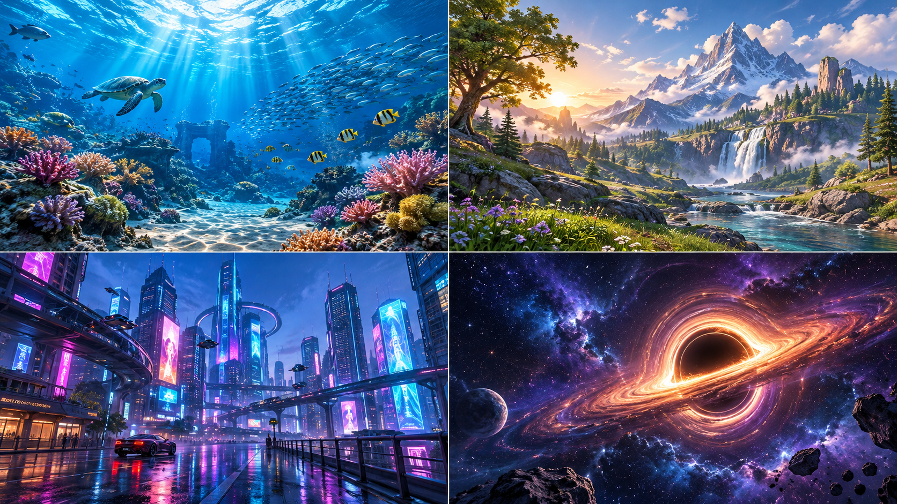
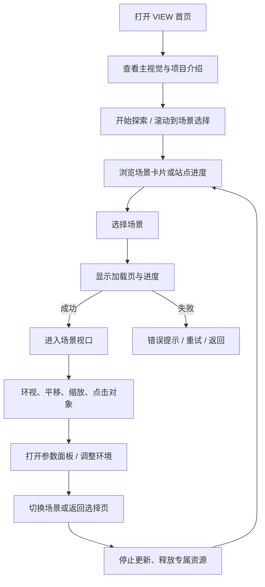
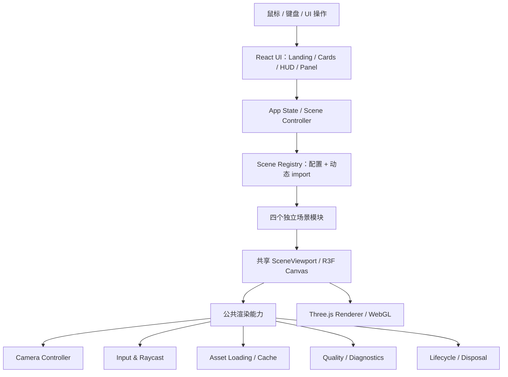
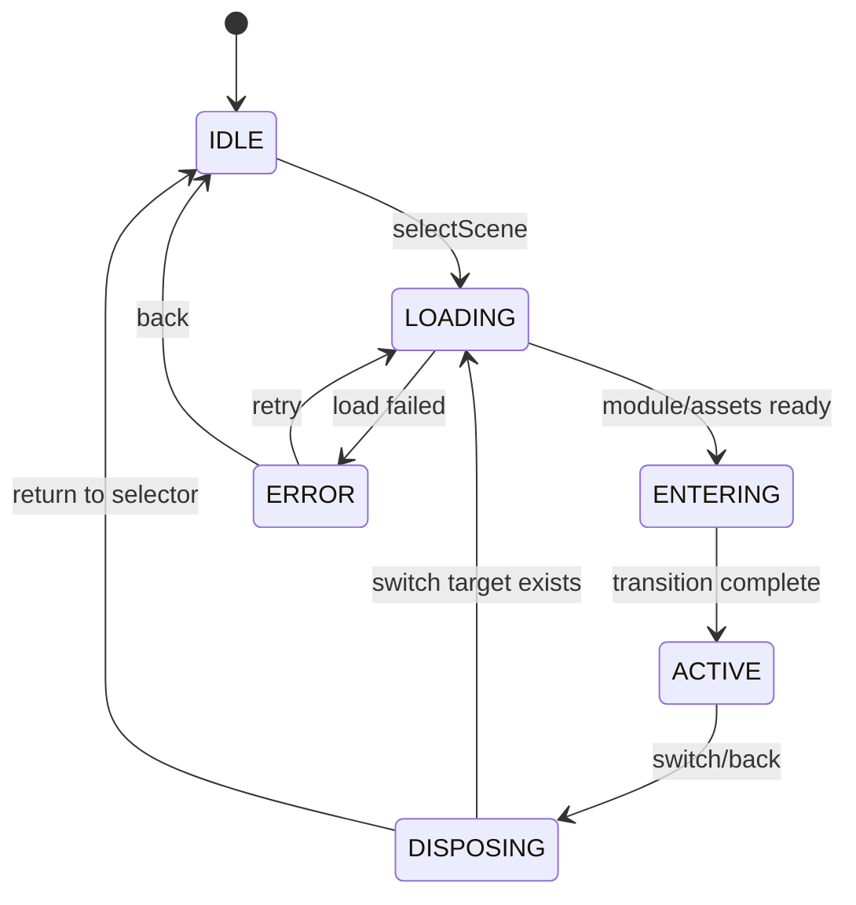

# VIEW｜场景实时渲染实践总体设计方案

> **项目名称：** VIEW（Visual Interactive Environment Worlds）  
> **项目类型：** WebGL / 实时三维场景渲染 / 技术美术综合实践  
> **课程周期：** 两周冲刺基线（可扩展至 3–4 周），独立开发  
> **技术基线：** React + TypeScript + Vite + Three.js + React Three Fiber  
> **文档版本：** V2.1（两周冲刺与工程规范版）  
> **文档定位：** 本文是项目范围、需求、架构、接口、开发顺序和验收的唯一总体依据；`instruction/` 用于分阶段学习与实现，不替代本文件。



---

## 0. 如何使用本方案

本项目有两类文档，职责必须分开：

- **plan.md（本文件）：** 回答“做什么、为什么做、系统如何组织、做到什么程度算完成”。本地 Agent 应先完整阅读本文件，再按阶段领取任务。
- **instruction/**：回答“某个效果是什么、背后的原理和算法是什么、如何在 Three.js / GLSL 中逐步实现、如何验证”。学习者按当前阶段阅读，不要求一次读完。

执行约束：
1. 先完成可运行的最小闭环，再逐项增加视觉效果；不允许先堆特效再补架构。
2. 需求优先级以本文件为准。超出 P0/P1 的内容不得挤占基础功能和稳定性时间。
3. 每个阶段结束必须能启动、能构建、能演示，并更新 `docs/PROGRESS.md`。
4. Agent 不得擅自更换技术栈、项目名称、交互约定或场景主题；如发现冲突，先提出方案和影响再修改。
5. 外部模型、纹理、HDR、音频必须登记来源和许可；占位资源必须标注，不得伪装成最终资源。

## 1. 项目定位与目标

### 1.1 项目定位

VIEW 是一个运行在桌面浏览器中的实时三维场景渲染与交互展示系统。用户通过首页选择主题场景，进入统一的三维视口，以接近 Blender 视口的方式观察场景，并通过 HUD 和可折叠参数面板调整场景表现。项目既要展示四类视觉风格，也要让开发者能够对场景中的关键参数进行实时实验。

本项目不是在线 3D 编辑器，不承担复杂建模、节点材质编辑、多人协作或云端项目管理。所谓“调试模式”仅提供受控的对象选择、变换和参数观察能力，以满足本次开发实践。

### 1.2 核心目标

- 建立统一、简洁、有探索感的前端入口与场景选择体验。
- 完成四类主题场景的基础空间组织和各自至少一个有辨识度的动态效果。
- 实现可靠的场景加载、切换、错误恢复和资源释放。
- 提供 Blender 风格的环视、平移、缩放与视角重置。
- 为每个场景提供语义明确的参数面板；开发调试模式可选择部分对象并调整位置、旋转、缩放。
- 以分阶段学习方式掌握关键效果的算法、渲染原理与 Shader 实现，而非只复制代码。
- 保证项目结构适合本地 Agent 按模块增量开发。

### 1.3 课程交付约束

- 独立开发，当前执行基线为两周（10 个工作日 + 预留缓冲）；若实际周期延长至 3–4 周，增加 P1/P2 深化，不改变架构原则。旧版 3–5 人分工、6–8 周排期不再适用。
- 课程交付包含实验报告、源程序、PPT 和答辩材料。
- 报告是从开发事实、关键技术和实验结果中提炼的课程论文，不应反过来主导工程结构。
- 课程原始要求截图保留在 `assets/课程实验要求原图.png`，作为验收映射依据。

### 1.4 设计原则

| 原则 | 项目落实方式 |
|---|---|
| 先闭环后精细 | 首页 → 选择 → 加载 → 交互 → 退出/切换完整跑通后，再做高级效果 |
| 场景独立 | 每个场景独立目录、配置、参数 schema、资源和效果组件 |
| 公共能力复用 | Canvas、相机、输入、加载、错误提示、质量档位和生命周期统一管理 |
| 参数数据化 | 标题、介绍、卡片、场景默认参数等放在配置数据中，不散落在 JSX |
| 调试与展示分离 | 用户模式只展示安全参数；开发模式才开放对象变换和诊断信息 |
| 视觉层级明确 | 每个场景先确定主视觉、辅助元素、远景层次，避免无目的堆模型 |
| 性能预算 | 粒子、实例、阴影、透明层和后处理均设置预算并可降级 |
| 可验证 | 每个功能对应可重复的验收步骤和截图/录屏证据 |
| 资源合规 | 所有外部资产登记来源、作者、许可、修改情况和用途 |

---

## 2. 范围管理与优先级

### 2.1 本次必须完成（P0）

1. React + TypeScript + Vite 工程可安装、启动、构建。
2. 首页包含品牌标识、项目名称、Explore / About 导航、主视觉、开始探索入口。
3. 场景选择区支持卡片浏览/翻页；展示缩略图、图标、名称、简介和当前站点进度。
4. 四个场景均可进入、返回、切换和重新进入。
5. 使用一个共享 Canvas/渲染视口，场景内容按需加载；切换时停止旧场景更新并释放场景专属资源。
6. 场景相机支持左键拖动环视、中键拖动平移、滚轮缩放、一键恢复默认视角；右键平移可作为兼容补充。
7. 场景 HUD 包含返回、场景名称/切换入口、操作提示、参数面板开关。
8. 参数面板可折叠；每个场景至少有两项有效参数，修改后可见效果变化。
9. 加载状态、加载失败、重试、WebGL 不可用等基本反馈可见。
10. Chrome / Edge 桌面版完成基本测试；窗口尺寸变化时画布正确适配。

### 2.2 重点争取完成（P1）

- 首页滚动叙事或横向分页与场景选择进度联动。
- 主视觉使用轻量 3D 地球/抽象球体，不为首页单独运行重型场景。
- 场景专属的标志性效果：水下光束/焦散近似、自然风动、城市霓虹 Bloom、黑洞吸积盘。
- 开发调试模式：射线拾取对象、显示 TransformControls、编辑对象变换并重置。
- 交互对象点击后显示说明卡片。
- 画质档位 Low / Medium / High，至少能控制 DPR、粒子数量、阴影或后处理。
- 场景转场淡入淡出或轻量相机过渡。

### 2.3 有时间再做（P2）

- WASD 第一人称漫游与 Orbit 模式切换。
- 环境音效、音量设置。
- 高级水体折射、真实体积光、复杂引力透镜、完整天气模拟。
- 完整昼夜系统、动态交通路径、复杂生态行为。
- 移动端专项交互、用户账户、云端保存、后端服务。

### 2.4 明确不做

- 不开发账号、数据库、后台管理或云端同步。
- 不做完整 3D 编辑器、任意材质节点编辑、模型导入编辑工作流。
- 不追求四个场景都达到商业游戏级资产精度。
- 不将物理精确模拟作为验收要求；视觉近似必须明确标注其边界。
- 不在一个迭代内同时追求全部高级 Shader、所有模型精修和所有 UI 动效。

### 2.5 风险与范围控制

独立开发、两周内完成四个场景，最大的风险是场景效果过多和并行集成成本。建议采用“**四场景完整基础版 + 每场景一个代表性效果 + 选择性深挖**”策略。若时间不足，优先保证四场景可进入、可观察、可退出和参数面板可用；高级效果可先完成水下和黑洞中的一项作为技术亮点，其余保留清晰的可扩展接口。

---

## 3. 用户流程与信息架构

### 3.1 主流程



### 3.2 首页布局

**顶部导航栏**
- 左侧：VIEW Logo + 项目名。
- 右侧：Explore、About；当前导航状态有清晰反馈。
- 导航保持简洁，不把所有场景入口塞入顶栏。

**主视觉区**
- 项目主题、副标题、开始探索按钮。
- 可使用地球/抽象球体/轨道作为 3D 视觉元素；优先使用低面数程序化几何体或静态渲染图，避免与场景视口争夺 GPU。
- 背景采用冷色、深空/渐变氛围，主标题和 CTA 对比清晰。

**场景选择区**
- 标题和一句引导语。
- 卡片展示概念缩略图、编号、图标、标题、简介、进入提示。
- 采用横向分页/轮播或左右翻页；底部“航线”进度条表示四个站点，站点标记与当前卡片同步。
- 小屏幕允许改为纵向卡片列表，不强行保留横向轨道。

**信息区 / About**
- 项目目标、技术栈、场景概览、资源致谢/来源、版本信息。
- 不需要在首页展示过多论文式技术段落。

### 3.3 加载页

- 显示当前场景名称、简短提示、加载进度（可获得真实进度时显示百分比；无法准确获得时使用不确定进度动画，不伪造百分比）。
- 可使用飞船/航线/扫描线等轻量动效。
- 提供加载失败说明和重试入口。
- 场景模块加载与模型/纹理加载需区分；界面应说明当前阶段。

### 3.4 场景展示页 HUD

- 顶部：返回按钮、场景标题/可折叠场景切换列表、帮助、参数面板入口。
- 左下：鼠标操作提示（可收起）。
- 右下或侧边：参数面板入口与状态。
- 可选装饰：摄像机取景框、REC、坐标/帧率等信息；装饰不能遮挡场景和交互目标。REC 仅作为视觉装饰，不应误导为真实录制功能。
- 参数面板默认收起或半透明，支持独立滚动。

### 3.5 交互规范

| 输入 | 默认行为 | 备注 |
|---|---|---|
| 鼠标左键拖动 | 围绕观察目标旋转 | 类 Blender 环视 |
| 鼠标中键拖动 | 平移视图 | 类 Blender Pan |
| 鼠标滚轮 | 缩放/推拉视图 | 限制最小/最大距离 |
| 鼠标右键拖动 | 可选平移或保留浏览器菜单策略 | 与中键保持一致或明确说明 |
| 双击 | 可选聚焦拾取对象 | P1，非必需 |
| R | 重置当前场景默认视角 | 输入焦点在表单时不触发 |
| Esc | 关闭最上层面板/弹窗 | 不应直接误退场景 |
| WASD | P2 第一人称模式移动 | 只在第一人称模式启用 |
| 点击场景对象 | 显示信息/选中反馈 | 射线拾取，不能让装饰物抢占点击 |

**实现提示：** Three.js OrbitControls 的默认鼠标映射与 Blender 不完全一致。应显式设置 `mouseButtons`：左键 ROTATE、中键 PAN、右键 PAN（或按实际体验约定）；滚轮保留 DOLLY。需要在目标浏览器验证中键事件和上下文菜单行为。

---

## 4. 需求规格说明（SRS）

### 4.1 功能需求

| ID | 功能 | 描述 | 优先级 | 验收点 |
|---|---|---|---|---|
| FR-01 | 首页与导航 | 品牌、项目主题、Explore/About、开始探索 | P0 | 导航跳转/滚动正常 |
| FR-02 | 场景选择 | 四张卡片、分页/翻页、航线进度同步 | P0/P1 | 卡片与站点状态一致 |
| FR-03 | 场景加载 | 动态加载场景模块与外部资源 | P0 | 加载中有反馈 |
| FR-04 | 场景切换 | 进入、退出、切换、过渡、失败恢复 | P0 | 连续切换无旧场景残留 |
| FR-05 | 统一视口 | 四场景复用单个 Canvas 和公共渲染设置 | P0 | 不重复创建全局 Canvas |
| FR-06 | 视角控制 | 左键旋转、中键平移、滚轮缩放、重置 | P0 | 操作映射符合约定 |
| FR-07 | HUD | 返回、场景名称、切换入口、提示、面板入口 | P0 | 层级清楚、可关闭 |
| FR-08 | 场景参数 | 每场景至少两项语义化参数 | P0 | 调节后场景即时变化 |
| FR-09 | 对象交互 | 点击对象显示信息或选中反馈 | P1 | 命中对象准确 |
| FR-10 | 调试模式 | 选择对象、位置/旋转/缩放调整、重置 | P1 | 不影响普通用户模式 |
| FR-11 | 画质设置 | Low/Medium/High | P1 | 关键质量项真实变化 |
| FR-12 | 加载/错误提示 | 进度、失败、重试、WebGL 不可用提示 | P0 | 不出现永久白屏 |
| FR-13 | 视口适配 | resize、DPR、窗口变化处理 | P0 | 画布尺寸与比例正确 |
| FR-14 | About 信息 | 项目简介、技术栈、资源来源 | P1 | 内容可从配置修改 |

### 4.2 非功能需求

| 类别 | 要求与验证方式 |
|---|---|
| 性能 | 目标桌面设备保持可操作的稳定帧时间；记录 FPS/帧时间、draw calls、三角形数和加载时间，不先承诺未经测试的固定 FPS |
| 兼容性 | 近期桌面 Chrome、Edge；WebGL 不可用或上下文丢失时显示提示 |
| 稳定性 | 连续进入/退出/切换场景不应持续累积 GPU 资源、事件监听器或动画循环 |
| 可维护性 | TypeScript 类型、模块边界、统一命名和格式化 |
| 可扩展性 | 新增场景只需配置元数据、场景组件和参数 schema，不改动其他场景内部 |
| 可用性 | 面板可折叠，操作提示可见，视角可重置，错误可恢复 |
| 资源合规 | 所有第三方资源可追溯，记录许可和署名要求 |
| 可访问性 | 关键操作有文字提示；避免仅靠颜色传递状态；减少动态效果选项可作为加分项 |

### 4.3 验收总表

- [ ] `npm install`、`npm run dev`、`npm run build` 均成功。
- [ ] 首页主视觉、导航、About 和场景选择可用。
- [ ] 四个场景均可进入、返回、切换、重复进入。
- [ ] 场景切换后旧场景不再更新，专属资源释放。
- [ ] 左键旋转、中键平移、滚轮缩放和重置视角正常。
- [ ] 每个场景至少两项参数有真实效果反馈。
- [ ] 加载失败、模型缺失或 WebGL 不可用时有可理解提示。
- [ ] 窗口 resize 后相机和 Canvas 正常。
- [ ] 连续切换场景后无明显性能持续恶化。
- [ ] 所有外部资源登记许可。
- [ ] 有可用于答辩的关键效果截图、短视频和技术说明。

---

## 5. 总体技术架构

### 5.1 技术栈与职责

| 层次 | 方案 | 用途 | 是否必须 |
|---|---|---|---|
| 构建 | Vite | 开发、构建、资源处理 | 是 |
| UI | React + TypeScript | 首页、导航、HUD、面板 | 是 |
| 3D | Three.js + React Three Fiber | 场景和渲染 | 是 |
| 辅助 | Drei | OrbitControls、TransformControls、加载辅助 | 推荐 |
| 状态 | Zustand 或轻量 Context | 场景状态、UI 状态、公共设置 | 推荐；避免过度状态化 |
| 后处理 | @react-three/postprocessing 或 Three addons | Bloom、色调映射等 | P1，按需引入 |
| 模型制作 | Blender | GLB 模型、UV、材质和动画 | 按资源需求 |
| 版本控制 | Git | 回滚和任务分支 | 是 |

不需要后端。场景数据、默认参数和资源元数据在前端管理；用户设置可暂存 localStorage（若实现），不做账户同步。

### 5.2 分层架构



### 5.3 模块职责

- **UI 层：** 只处理界面状态、输入控件和用户反馈，不直接操作大量 Three.js 对象。
- **App / Scene Controller：** 管理当前场景 ID、加载状态、场景切换和错误恢复。
- **Scene Registry：** 集中保存场景 ID、标题、简介、缩略图、加载函数和默认相机配置。
- **SceneViewport：** 唯一共享 Canvas，负责 renderer、camera、controls 和当前场景挂载。
- **场景模块：** 管理自己的模型、灯光、动画、拾取目标、参数 schema 和专属资源。
- **Engine 公共层：** 提供相机、输入、资源缓存、质量档位、调试辅助和生命周期能力。
- **Assets：** 模型、纹理、HDR、音频和图片按场景分类，外部资源登记来源。

### 5.4 推荐目录结构

```text
VIEW/
├── public/
│   └── assets/
│       ├── models/{underwater,nature,city,space}/
│       ├── textures/{underwater,nature,city,space}/
│       ├── hdr/
│       ├── images/scenes/
│       ├── audio/
│       └── fonts/
├── src/
│   ├── app/
│   │   ├── App.tsx
│   │   ├── sceneRegistry.ts
│   │   └── sceneController.ts
│   ├── components/
│   │   ├── Navbar/
│   │   ├── SceneCard/
│   │   ├── SceneSelector/
│   │   ├── LoadingScreen/
│   │   ├── HUD/
│   │   └── SettingsPanel/
│   ├── engine/
│   │   ├── SceneViewport.tsx
│   │   ├── CameraController.tsx
│   │   ├── InputManager.ts
│   │   ├── AssetManager.ts
│   │   ├── QualityManager.ts
│   │   ├── DebugTransform.tsx
│   │   └── lifecycle.ts
│   ├── scenes/
│   │   ├── underwater/{UnderwaterScene.tsx,config.ts,components/}
│   │   ├── nature/{NatureScene.tsx,config.ts,components/}
│   │   ├── city/{CityScene.tsx,config.ts,components/}
│   │   └── space/{SpaceScene.tsx,config.ts,components/}
│   ├── stores/
│   ├── hooks/
│   ├── types/
│   ├── utils/
│   ├── styles/
│   └── main.tsx
├── docs/
│   ├── PROGRESS.md
│   ├── ASSET_CREDITS.md
│   └── TEST_REPORT.md
├── instruction/ (学习文档在项目策划包中；开发仓库可复制)
├── README.md
├── package.json
└── vite.config.ts
```

目录可按实际代码规模增减；不要为“看起来完整”而提前创建大量空文件。

### 5.5 场景注册接口

建议使用数据配置 + 动态加载函数，避免 UI 写死四个场景：

```ts
export type SceneId = 'underwater' | 'nature' | 'city' | 'space';
export type Quality = 'low' | 'medium' | 'high';

export interface SceneMeta {
  id: SceneId;
  order: number;
  title: string;
  subtitle: string;
  description: string;
  thumbnail: string;
  accent: string;
  load: () => Promise<{ default: React.ComponentType<SceneRuntimeProps> }>;
}

export interface SceneRuntimeProps {
  active: boolean;
  quality: Quality;
  onReady?: () => void;
  onError?: (error: Error) => void;
  debugEnabled: boolean;
}
```

每个场景还应导出自己的参数类型与默认配置。公共场景接口只传递生命周期和质量等通用信息，不把所有场景参数强行合并成一个巨大接口。

### 5.6 场景状态机



状态定义：`idle / loading / entering / active / disposing / error`。切换过程中应防止重复点击触发多个并行加载；新请求到来时需明确采用排队、取消或覆盖策略，MVP 推荐禁用切换按钮直到当前过渡结束。

### 5.7 资源生命周期约定

- React 组件卸载时，R3F 会处理部分对象移除，但自定义创建的 GPU 资源、事件监听器和外部订阅仍需明确管理。
- 场景独占的 geometry/material/texture 在退出时释放；共享资源由公共 AssetManager 或引用计数缓存管理。
- 禁止场景 A dispose 场景 B 仍在使用的共享纹理。
- `useFrame` 中不得每帧调用 React setState；高频运动使用 ref、typed array、shader uniform 或实例矩阵更新。
- 动态创建的事件监听器、定时器、动画控制器必须在 cleanup 中注销。
- 不要无差别遍历并 dispose 所有 children；先明确资源所有权。

---

## 6. 相机、输入与调试交互设计

### 6.1 相机模式

**MVP：Orbit / 轨道观察模式。** 以场景观察目标为中心，支持旋转、平移、缩放和重置。每个场景注册自己的默认相机位置、目标点、最小/最大距离和极角限制。

**P2：第一人称模式。** 仅在 Orbit 模式稳定后添加，使用 Pointer Lock 或自定义键盘移动；不与 Orbit 输入同时抢占。

### 6.2 Blender 风格鼠标映射

- 左键：旋转（Rotate）。
- 中键：平移（Pan）。
- 滚轮：缩放（Dolly）。
- 右键：可选平移；若使用，需阻止上下文菜单并确保不会影响浏览器常规操作。
- 视角重置：恢复当前场景默认 camera position + target。

### 6.3 参数面板的两层模式

**用户模式（默认）**
- 展示场景语义参数，如鱼群速度、光束强度、风力、植被密度、霓虹强度、星尘数量。
- 控件使用 slider、toggle、select、preset。
- 每项有中文标签、数值范围、单位/解释和恢复默认值。

**开发调试模式（显式开启）**
- 显示选中对象名称和必要诊断信息。
- Raycaster 选择允许编辑的对象。
- 使用 Drei `TransformControls` 提供 translate / rotate / scale。
- 提供对象变换重置。
- 允许显示坐标轴、包围盒、网格、FPS / draw calls（如实现）。
- 调试状态不应写入全局 UI 每帧刷新；变换完成时再提交到配置/状态。

限制：本次调试模式不做通用场景层级树、任意模型拖入、材质节点编辑和序列化工程文件。

---

## 7. 四类场景总体设计

四个场景必须有清晰的空间构成：前景 / 中景 / 远景，明确主视觉焦点、辅助动势和环境光色。每个场景先使用基础几何体验证空间比例，再替换高质量模型。

### 7.1 水下景观｜Underwater

**目标氛围：** 写实倾向、深蓝/青绿色层次、远景吸收与雾化、顶部光束、海底生态。

| 子系统 | 内容 | 初始实现 | 深化方向 |
|---|---|---|---|
| 海底地形 | 沙地、坡面、岩石、沟壑 | Plane/高度函数/低模岩石 | 高度图、顶点位移、坡度材质混合 |
| 生态资产 | 珊瑚、海草、海绵 | 少量 GLB/占位几何 | 实例化、LOD、分布规则 |
| 鱼群 | 群集、环绕、波浪队形 | 先做路径/正弦运动 | Boids 分离/对齐/聚合、空间分桶 |
| 水体氛围 | 水色吸收、远景雾化 | Fog + 色彩分级近似 | 深度相关颜色吸收、雾/散射近似 |
| 光束 | 顶部方向性光柱 | 透明锥体/平面渐变 | Shader 软边、噪声扰动、深度衰减 |
| 焦散 | 海底动态光斑 | 滚动噪声纹理 | 多频噪声/焦散纹理 Shader |
| 粒子 | 气泡、悬浮颗粒 | Points | GPU 粒子/实例化与生命周期 |

**鱼群聚集方式：** 至少定义三种可切换模式：School（Boids 局部群集）、Orbit（围绕中心/路径环绕）、Wave（沿路径推进并叠加波形）。先实现可观察的模式差异，再追求复杂行为。

**用户参数：** 鱼群模式、数量、速度、群集强度、光束强度、雾浓度、气泡开关。MVP 至少实现其中两项。

**交互对象：** 点击一类鱼或珊瑚显示名称/简述；不要让所有粒子都成为拾取目标。

### 7.2 风格化自然地貌｜Nature

**目标氛围：** 风格化山地作为远景边界，森林分布于边缘或坡面，中心草场/河谷形成视觉通道；天空和大气承担空间层次。

| 子系统 | 内容 | 初始实现 | 深化方向 |
|---|---|---|---|
| 地形 | 山体、丘陵、谷地 | 多频噪声高度函数或手工网格 | FBM、域扭曲、分块 LOD |
| 地表材质 | 草、土、岩 | 基于高度/坡度的颜色混合 | splat map、多层 PBR |
| 植被分布 | 树、草、灌木 | 规则采样 + 随机扰动 | 基于坡度/高度权重采样、实例化 |
| 风动 | 草叶、树冠摆动 | CPU 正弦摆动 | 顶点 Shader + 高度权重 + 风向噪声 |
| 天空 | 渐变天空/天空盒 | Sky/背景色 | 大气散射、太阳高度变化 |
| 大气 | 远景雾 | Fog | 高度雾/距离雾近似 |
| 水体（可选） | 河流、湖泊 | 平面 + 纹理滚动 | Fresnel、法线扰动、反射近似 |

**空间构图建议：** 山地作为地基和远景轮廓，森林沿边缘分布，草场/河谷在中心留出视觉通道。避免随机散布树木导致场景无主次。

**用户参数：** 风力、植被密度、时间/天空预设、雾浓度。

### 7.3 未来科技城市｜City

**目标氛围：** 夜间未来城市、建筑群高低错落、霓虹冷暖对比、道路形成透视引导，动态交通作为次级动势。

| 子系统 | 内容 | 初始实现 | 深化方向 |
|---|---|---|---|
| 建筑群 | 模块化高楼、地标 | 程序化盒体组合 | 参数化建筑模块、实例化、LOD |
| 自发光 | 窗灯、灯带、广告屏 | emissive 材质 | UV 动态纹理/Shader |
| 交通 | 车辆/飞行器路径 | 曲线参数动画 | CatmullRomCurve3、实例化车辆 |
| 道路 | 车道、标识、地面 | 平面和线段 | 湿地反射近似、道路贴花 |
| 天气 | 雨、雾 | 粒子雨 + Fog | 屏幕空间雨滴/湿润材质 |
| 后处理 | Bloom | 可选 EffectComposer | 强度/阈值调优与低画质降级 |

**用户参数：** 霓虹强度、交通速度、雨量/天气预设、雾浓度。

### 7.4 黑洞与太空｜Space

**目标氛围：** 深色背景、星空层次、黑洞视觉中心、吸积盘形成明亮环带；以科学启发的视觉近似为主，不宣称真实物理模拟。

| 子系统 | 内容 | 初始实现 | 深化方向 |
|---|---|---|---|
| 星空 | 不同亮度/尺度星点 | Points/Sparkles | 分层星场、GPU 粒子 |
| 星云 | 远景云团 | 贴图/平面 | 噪声 Shader、体积近似 |
| 黑洞中心 | 暗色球体/事件视界 | 黑色球体 + 发光边缘 | 屏幕空间 UV 扭曲近似 |
| 吸积盘 | 旋转发光盘 | Torus/环带 | Shader 径向渐变、噪声、速度场 |
| 引力透镜 | 背景星点偏折 | 可选后处理 UV distortion | 屏幕空间采样、距离衰减、边界处理 |
| 粒子 | 星尘/喷流 | Points | GPU 更新、生命周期 |

**用户参数：** 吸积盘速度、发光强度、星尘数量、透镜扭曲强度（若实现）。

---

## 8. 技术美术与 Shader 学习原则

### 8.1 先选实现层级

一个视觉效果不一定需要自定义 Shader。每次实现前先比较：
1. **现成 Three.js 能力：** Fog、材质、灯光、几何体、Points、实例化。
2. **程序化几何/动画：** CPU 生成网格、路径、顶点或实例变换。
3. **材质参数/纹理动画：** 滚动 UV、混合纹理、emissive。
4. **自定义 Shader：** 当需要逐像素控制、顶点位移或特殊屏幕空间效果时再使用。
5. **后处理：** 需要对最终画面整体处理（Bloom、色调映射、扭曲）时使用。

不应为了“用 Shader”而将简单效果复杂化。

### 8.2 Shader 开发约定

- 先理解坐标空间：模型空间、世界空间、视图空间、裁剪空间、屏幕/UV 空间。
- 明确每个 uniform 的含义、范围、单位和更新频率。
- 将静态计算放在 CPU/初始化阶段；逐帧变化只更新必要 uniform 或 buffer。
- 先做单一效果，再叠加噪声、光照、深度和后处理。
- 每个 Shader 提供 fallback：低画质关闭或替换为基础材质。
- Shader 代码需要注释输入、输出、关键公式和限制；不能只交一段不可解释的 GLSL。

### 8.3 本项目重点学习主题

- Boids 鱼群：向量运算、邻域搜索、分离/对齐/聚合、空间分桶。
- 程序化地形：噪声叠加、FBM、高度函数、坡度与高度材质混合。
- 风动 Shader：顶点位移、时间函数、顶点高度权重、风向和噪声。
- 水下光束/焦散：透明混合、软边、噪声扰动、UV 滚动、距离衰减。
- Bloom：HDR/高亮阈值、亮部提取、模糊、合成、色调映射。
- 黑洞吸积盘/透镜：极坐标、径向渐变、UV 扭曲、屏幕空间采样与边界。

具体教学和逐步实验见 `instruction/`。

---

## 9. 资源规划与资产管线

### 9.1 资源类型

| 类型 | 用途 | 推荐格式 |
|---|---|---|
| 3D 模型 | 鱼、珊瑚、树木、建筑、车辆 | GLB / glTF |
| 贴图 | 地表、建筑、法线、粗糙度、噪声 | PNG / JPG / WebP |
| 环境贴图 | 天空、环境光 | HDR / EXR（按加载器支持） |
| 特效纹理 | 焦散、噪声、星云、渐变 | PNG/WebP 或程序生成 |
| 图像 | 首页卡片、About 配图 | WebP/PNG |
| 字体/图标 | 标题、说明、HUD | WOFF2 / SVG |
| 音效 | 水下、风、城市氛围 | OGG/MP3/WAV（可选） |

### 9.2 资源获取与合规

可研究 Poly Haven、ambientCG、Kenney、Sketchfab 等来源，但每个具体文件都必须核对许可，不能仅凭网站整体印象认定所有资源许可相同。模型需记录作者、下载页、许可证、署名要求、是否修改、用途和优化情况。

建立 `docs/ASSET_CREDITS.md`，至少包含：资源名、类型、作者、URL、License、署名文本、使用位置、修改记录。

### 9.3 模型导入检查

- 统一单位、比例、朝向和原点。
- 检查法线、UV、材质槽和透明材质。
- 控制多边形数、材质数、纹理尺寸。
- 重复物体使用 InstancedMesh；远景使用简化模型。
- 需要动画时检查骨骼和 AnimationClip。
- 视情况采用 Draco/Meshopt 几何压缩和 KTX2 纹理压缩；不要在未验证解码器配置前强制启用。

---

## 10. 性能、诊断与稳定性

### 10.1 性能预算原则

先测量，再优化。每个场景建立自己的预算记录：DPR、draw calls、三角形数、粒子数、透明物体数量、阴影灯数量、后处理 pass、资源加载大小。

优先优化顺序：
1. 控制 DPR 和画布分辨率。
2. 降低不必要的 draw calls（InstancedMesh / 合批）。
3. 控制透明物体、阴影和后处理开销。
4. 控制粒子数量和更新成本。
5. 远景使用 LOD / 简化几何体。
6. 按需加载模型与纹理，避免首屏一次性加载全部场景资源。

### 10.2 质量档位建议

| 设置 | Low | Medium | High |
|---|---|---|---|
| DPR 上限 | 1.0 | 1.5 | 2.0（需实测） |
| 阴影 | 关闭/简化 | 单主光源 | 适度提高分辨率 |
| 粒子 | 低 | 中 | 高 |
| Bloom | 关闭 | 低分辨率/低强度 | 完整但受预算约束 |
| 水体/雾 | 简化 | 常规 | 额外细节 |

### 10.3 诊断数据

- FPS 或 frame time；
- `renderer.info.render.calls`；
- triangles / points；
- geometry / texture 数量；
- 首次进入场景的加载耗时；
- 连续切换场景前后的资源数量趋势；
- 控制台错误、WebGL context lost。

调试信息仅在开发模式或用户主动打开时显示。

---

## 11. 3–4 周独立开发计划

按四周排期，若实际只有三周则压缩 P1，不压缩 P0 和测试。

| 阶段 | 时间 | 目标 | 交付 |
|---|---|---|---|
| Week 1 / 基础骨架 | 第 1 周 | 工程、首页、场景选择、共享 Canvas、相机、状态机 | 可运行框架；占位四场景可切换 |
| Week 2 / 四场景基础 | 第 2 周 | 四场景空间构图、资源导入、基础动态、参数 schema | 四场景基础版；资源清单 |
| Week 3 / 关键效果与交互 | 第 3 周 | 每场景代表效果、HUD、参数面板、对象拾取、调试模式 | 主要视觉效果与交互完成 |
| Week 4 / 稳定与交付 | 第 4 周 | 资源清理、性能、兼容性、测试、答辩材料 | 构建稳定版本、测试记录、截图/录屏、报告素材 |

**三周压缩方式：** Week 1 保留；Week 2 完成四场景低成本基础版；Week 3 只深化 1–2 个关键 Shader，其余完成交互、稳定性和答辩材料。不要为了做完全部 P2 而牺牲可运行性。

### 每周完成定义

- **Week 1：** 从首页可进入任意占位场景；返回和切换不白屏；相机映射正确。
- **Week 2：** 四个场景均有前中远景构成、至少一个动态效果、两项参数。
- **Week 3：** 场景标志效果可演示；面板、对象交互和调试模式按优先级完成。
- **Week 4：** 构建成功、资源来源完整、测试用例通过、演示流程稳定。

---

## 12. 测试用例与课程答辩映射

### 12.1 核心测试

| ID | 操作 | 预期结果 |
|---|---|---|
| T01 | 首页打开 | 主视觉、导航和场景卡片正常 |
| T02 | Explore 导航/开始按钮 | 定位到场景选择区 |
| T03 | 卡片翻页 | 卡片与航线站点同步 |
| T04 | 进入四个场景 | 均显示加载反馈并成功进入 |
| T05 | 左键拖动 | 环视旋转正确 |
| T06 | 中键拖动 | 相机平移正确 |
| T07 | 滚轮 | 缩放范围受限且平滑 |
| T08 | 重置视角 | 恢复当前场景默认视角 |
| T09 | 调节场景参数 | 对应视觉效果即时变化 |
| T10 | 折叠参数面板 | 不影响场景运行与视角操作 |
| T11 | 切换场景 | 旧场景停止，目标场景加载 |
| T12 | 连续切换 10 次 | 无明显资源累积/崩溃 |
| T13 | 模拟资源失败 | 显示错误、重试和返回入口 |
| T14 | 浏览器窗口 resize | Canvas 与相机比例正确 |
| T15 | Debug 选中对象 | 对象信息与变换控件正确 |
| T16 | 关闭 Debug | 变换控件和拾取辅助消失 |

### 12.2 答辩内容建议

1. 选题目的与四类场景设计逻辑。
2. 系统架构与模块独立性。
3. 核心场景演示和交互操作。
4. 关键效果的算法/Shader 原理：至少讲清输入、计算过程、输出和性能权衡。
5. 性能测试与资源优化。
6. 项目不足、视觉近似边界和后续改进。

报告中的技术描述必须对应真实代码与实际测试结果，不能把计划实现写成已实现。

---

## 13. Agent 执行约定（必须遵守）

### 13.1 开始任务前

1. 阅读本 `plan.md` 和当前阶段对应 instruction。
2. 检查仓库现状、package.json、已有组件和未提交修改；不得覆盖用户已有代码。
3. 输出简短实施计划：将改哪些文件、接口影响、验收方式。
4. 任务范围不清楚时先提出问题，不自行扩展为大型重构。

### 13.2 编码约束

- TypeScript 严格类型；避免 `any`，确需使用时说明原因。
- 场景组件不得创建独立全局 Canvas。
- 场景不得直接依赖其他场景内部文件。
- React 状态不承载每帧坐标；动画放在 `useFrame`、ref、buffer 或 shader uniform。
- 所有异步加载有 loading/error 路径。
- 所有事件监听和订阅有 cleanup。
- 资源所有权明确；共享资源不得被单个场景随意 dispose。
- UI 文案、场景元数据和默认参数尽量配置化。
- 每个功能完成后运行 lint/typecheck/build（项目配置存在时）并修复新增错误。
- 不得伪造测试结果、加载进度、性能数据或素材许可证。

### 13.3 每次任务交付格式

Agent 完成一个任务后，必须汇报：
1. 完成内容与对应需求 ID；
2. 修改/新增文件清单；
3. 关键实现说明和设计取舍；
4. 执行过的检查命令及真实结果；
5. 未完成事项、风险和下一步建议；
6. 如涉及视觉效果，提供本地复现步骤和截图/录屏建议。

### 13.4 禁止行为

- 未经确认重命名项目、重构目录或替换技术栈。
- 将所有功能写进一个 App.tsx。
- 为了展示“模块化”而创建无意义抽象层。
- 未核对许可就下载/提交来源不明素材。
- 用高成本后处理掩盖基础场景构图问题。
- 将视觉近似描述为真实物理模拟。

---

## 14. 后续论文/实验报告如何从工程中提炼

建议工程先行，报告后写。开发过程中持续保存：
- 需求与设计决策；
- 每个效果的算法流程和关键公式；
- Shader 关键代码与参数说明；
- 资源来源和模型优化前后对比；
- FPS、draw calls、三角形数、加载耗时等测试数据；
- 不同实现方案的效果和性能比较；
- 实际遇到的问题、原因、排查和解决过程。

这些内容将成为后续课程论文、实验报告和 PPT 的真实证据。不要先写无法由工程验证的结论。

---

## 15. 总结

VIEW 的目标不是在有限周期内制造四个庞大而未完成的 3D 世界，而是交付一个稳定、结构清晰、具有交互闭环的多场景实时渲染系统。四个场景共享公共视口与基础设施，内部效果独立实现；前端承担导航、状态、加载反馈和参数交互；Three.js/R3F 承担实时场景组织和渲染；instruction 则帮助开发者理解每项效果背后的算法和图形学原理。

**最终完成标准：用户能够从首页进入四个主题场景，以约定的鼠标操作观察场景，调整各场景关键参数，并可靠地返回或切换；开发者能够解释主要效果的实现原理，且可以通过新增场景模块继续扩展系统。**


---

## 16. 两周冲刺执行计划（当前基线）

本节优先级高于旧版第 11 节的 3–4 周排期。两周按 10 个工作日估算，周末/缓冲时间用于修复，不将计划当作无条件承诺。Agent 可以并行产出，但集成、验收和视觉决策仍由项目负责人把关。

| 日程 | 主线任务 | 并行任务 | 当日验收/交付 |
|---|---|---|---|
| Day 1 | 工程初始化、目录/规范、共享 Canvas、场景注册与状态机 | UI 线完成首页静态骨架；各场景 Agent 阅读接口 | 四个占位场景可进入/退出；dev/build 通过 |
| Day 2 | 相机控制、加载/错误状态、公共 HUD | 四场景分别搭建空间灰盒与默认相机 | 四场景构图可观察，控制统一 |
| Day 3 | 参数 schema、场景懒加载、基础资源管线 | 四场景各完成基础模型/几何和一项动态 | 每场景可运行且至少一项动态 |
| Day 4 | 公共质量档位、拾取/调试框架 | 水下鱼群/自然风动深化；城市/太空视觉深化 | 四场景有辨识度，参数至少两项可调（逐场景验收） |
| Day 5 | 统一面板、加载体验、切换过渡 | 重点 Shader 原型与资源优化 | 完成中期集成演示，冻结 P0 范围 |
| Day 6 | 集成修复、共享资源与生命周期审查 | 各场景补代表性效果 | 连续切换 10 次无明显残留/错误 |
| Day 7 | 性能测量与画质降级 | 实例化、LOD、粒子/后处理优化 | 记录基线与优化前后数据 |
| Day 8 | UI/UX 收尾、调试模式 | 资源许可核对、场景细节完善 | 三类面板可用，资源表完整 |
| Day 9 | 全量回归、跨浏览器与异常路径 | 截图、录屏、技术说明整理 | P0 测试全部通过或列明阻塞项 |
| Day 10 | 修复、构建、打包、答辩演示流程 | README/报告素材整理 | Release 候选版本、测试报告、演示脚本 |

**范围闸门：** Day 1–3 优先保障 P0；Day 4–5 完成四场景代表性效果；Day 6 后禁止大规模架构重构。若进度落后，依次削减复杂后处理、次要粒子、额外交互和高级模拟，不削减场景切换稳定性、基本参数交互、错误处理与构建验证。

### 16.1 并行开发建议

- 主 Agent/技术负责人：工程骨架、公共接口、场景注册、合并、质量门禁。
- 场景 Agent A：水下；Agent B：自然；Agent C：城市；Agent D（可选）：太空或 UI/测试。若 Agent 数量有限，城市与太空可由同一 Agent 分阶段完成。
- 所有场景 Agent 只能在各自 `src/scenes/<scene-id>/` 与明确分配的资源目录内工作；公共层修改必须先提交接口提案，不得自行复制公共系统。
- 并行前先提交接口契约和空场景 stub；公共接口冻结后再并行实现。

---

## 17. 软件工程设计原则与代码规范

本项目追求“适度工程化”：让代码易读、可测试、可替换、便于 Agent 分工；不为了形式引入复杂微服务、过度抽象或大型状态管理体系。

### 17.1 核心原则

| 原则 | 在 VIEW 中的落地要求 |
|---|---|
| 单一职责（SRP） | UI 组件负责展示；Scene Controller 管流程；场景模块负责场景内容；Engine 管公共 3D 能力 |
| 开闭原则（OCP） | 新场景通过注册表扩展，不修改既有场景实现；公共接口稳定扩展 |
| 依赖倒置（DIP） | UI 依赖 SceneMeta/SceneId 等接口，不直接 import 场景内部组件或资源 |
| 接口隔离（ISP） | 场景只接收所需的 runtime props；不创建一个包含所有场景参数的巨型 props |
| 组合优于继承 | 用小组件组合灯光、地形、粒子、交互和效果，不构建深层继承体系 |
| DRY 但避免过度抽象 | 重复且稳定的逻辑才抽公共模块；仅出现一次且语义特殊的逻辑留在场景内 |
| 数据与表现分离 | 场景元数据、默认参数、资源清单、质量配置独立于 JSX/渲染逻辑 |
| 显式生命周期 | 异步加载、订阅、事件、GPU 资源和动画均有明确创建/清理路径 |
| 可测试与可观测 | 纯算法独立测试；状态流可追踪；性能指标可记录 |

### 17.2 分层依赖规则

允许依赖方向：`app → components / engine contracts / scene registry`；`scenes → engine public APIs / shared types / own modules`；`engine → shared types / Three.js`。禁止 `scene A → scene B`、`engine → app UI`、`scene → app 页面组件`、`UI → 场景私有实现`。避免循环依赖。

### 17.3 场景模块契约

每个场景建议具备 `index.ts`（公开导出）、`Scene.tsx`（组合根）、`config.ts`（默认相机/质量参数）、`params.ts`（参数类型与 schema）、`components/`（内部子系统）、`hooks/`（场景专属 hooks）、`utils/`（纯算法）。仅通过注册表暴露场景元数据与 lazy loader。不要把内部组件导出给其他场景。

### 17.4 TypeScript 与 React 规范

- 开启 `strict`；优先 `unknown` + 类型收窄，避免 `any`。
- Props、事件、场景参数、资源元数据显式定义类型；避免无意义的类型断言。
- 组件保持小而语义明确；复杂 UI 拆为可复用子组件。
- `useFrame` 中不调用 React `setState` 做逐帧更新；使用 `ref`、`useMemo`、TypedArray、实例矩阵或 uniforms。
- `useMemo` 用于稳定创建昂贵对象；不要每帧 new Vector3/Color/Material/Geometry。
- 事件监听、订阅、控制器和自建资源必须在 cleanup 中释放。
- 禁止在渲染函数中执行有副作用的资源加载、全局注册或事件绑定。

### 17.5 命名、文件与注释

- 组件/类型：PascalCase；变量/函数：camelCase；常量：UPPER_SNAKE_CASE（仅真正常量）；文件命名与导出主体一致。
- 命名表达领域含义，如 `schoolingStrength`，避免 `value1`、`doStuff`。
- 注释解释“为什么”和非显然约束，不复述代码。
- Shader 注释需说明坐标空间、uniform 单位/范围、关键公式、近似假设和性能代价。
- 每个复杂算法提供独立纯函数或模块，并附复杂度/输入约束说明。

### 17.6 错误处理与日志

- 异步资源加载需区分 loading / success / error；错误信息对用户友好，控制台保留可诊断上下文。
- 不吞掉异常；不使用空 catch。
- 日志避免每帧输出；开发诊断统一开关控制。
- 场景错误应能回退到选择页或重试，不允许白屏卡死。

### 17.7 测试策略

- 纯算法（Boids 邻域、噪声采样、参数边界、路径采样）优先单元测试。
- 场景状态机、注册表、参数 schema 做逻辑测试。
- UI 主流程做组件/浏览器冒烟测试（若测试工具配置可行）。
- Three.js 视觉效果至少进行人工浏览器验收，并记录浏览器、分辨率、质量档位和截图。
- 每次提交至少运行 `npm run build`；如仓库配置了 lint/typecheck/test，则一并运行。

---

## 18. Three.js / R3F 技术选型与优化规范

采用“先用库已有能力，再写自定义实现”的原则。Three.js 与 R3F 的封装可以减少样板代码，但不自动保证性能；必须理解其底层成本和生命周期。

| 能力/API | 推荐用途 | VIEW 场景 | 注意事项 |
|---|---|---|---|
| `InstancedMesh` | 同几何/材质的大量重复物体 | 树木、草丛、窗户、重复岩石/珊瑚、简单鱼体 | 减少 draw calls；实例仍有顶点/片元成本；个体骨骼动画不适用普通实例方案 |
| `BufferGeometry` | 自定义顶点属性/动态网格 | 地形、路径、程序化网格 | 尽量复用 buffer；动态更新设置合理 usage 和更新范围 |
| `Points` / `BufferAttribute` | 大量轻量点粒子 | 气泡、星空、雨滴、尘埃 | 控制点尺寸、透明 overdraw；粒子行为可 CPU 或 GPU 更新 |
| `LOD` | 距离驱动模型精度 | 远景山体、树木、城市建筑 | 需要准备多级模型并实测切换阈值 |
| Frustum Culling | 剔除视锥外对象 | 所有场景 | Three.js 对普通对象默认支持；自定义/变形几何需保证 bounding sphere/box 正确 |
| `InstancedBufferGeometry` / 自定义 Shader | 特殊实例属性与 GPU 动画 | 鱼群、植被风动、重复动态元素 | 复杂度更高，先建立 CPU/普通实例版本作为基线 |
| `GLTFLoader` | 加载 glTF/GLB | 全部模型资源 | 模型导入后检查材质、色彩空间、比例、动画与资源复用 |
| Draco / Meshopt | 几何压缩/优化 | 大型 GLB | 需正确配置 decoder；压缩降低传输体积但增加解码成本 |
| KTX2 / Basis | GPU 纹理压缩 | 大型贴图、环境纹理 | 需检测设备支持并准备 fallback；压缩格式/质量要实测 |
| Drei `useGLTF` | R3F 模型加载与缓存 | React 场景 | 缓存资源是共享所有权；不能由单场景随意 dispose 缓存对象 |
| Drei `OrbitControls` | 轨道相机交互 | 公共视口 | 配置鼠标映射、阻尼、距离边界；不要每个场景创建独立 Canvas |
| Drei `TransformControls` | 调试对象变换 | Developer Panel | 仅开发模式启用；处理与 OrbitControls 的输入冲突 |
| `EffectComposer` / R3F postprocessing | Bloom 等屏幕后处理 | 城市、太空、水下局部 | 多 pass 成本高；按场景/质量档启停；控制分辨率与阈值 |
| `renderer.info` | draw calls、几何/纹理数量等诊断 | 全部场景 | 作为趋势指标，不等于完整 GPU 显存/耗时；frame time 需另行测量 |

### 18.1 优化决策顺序

1. 先做正确、可运行的基础实现并测量基线。
2. 减少不必要的对象和材质数量，复用 geometry/material/texture。
3. 重复网格考虑 `InstancedMesh`；大量点状元素考虑 `Points`。
4. 控制 DPR、阴影、透明层和后处理；避免无意义的高分辨率渲染。
5. 对远景采用 LOD / 简化资产；依赖默认 Frustum Culling 时检查包围体。
6. 对传输瓶颈评估 Draco/Meshopt/KTX2，并记录解码与加载收益。
7. 只有 CPU 更新成为瓶颈时，再考虑 GPU 粒子/自定义实例 Shader。

### 18.2 场景对应策略

- 水下：鱼群若共享几何/材质且动画可用实例矩阵表达，采用 InstancedMesh；复杂骨骼鱼不能直接套普通实例。Boids 使用空间网格分桶降低邻域搜索成本；气泡/浮游物优先 Points。
- 自然：树木/草丛按模型类型和材质分批实例化；远景树与山体使用 LOD；风动优先顶点 Shader，避免每株植物单独 React 更新。
- 城市：重复窗户、灯带模块和建筑组件优先复用/实例化；建筑按距离降级；Bloom 控制 pass、分辨率和阈值。
- 太空：星点优先 Points；吸积盘以少量网格 + Shader 表现；避免把每颗星做成独立 Mesh；屏幕空间扭曲按质量档关闭或降采样。

### 18.3 资源所有权与 R3F 注意事项

- R3F 会管理其声明式对象树中的常规挂载/卸载，但通过 `useMemo`、loader cache、外部工厂或命令式 API 创建的资源需要确认所有权和释放策略。
- 共享缓存资源由 AssetManager/缓存层管理；场景只能释放自己独占的资源。
- 不要在场景卸载时对 `useGLTF` 缓存中的共享材质/几何体盲目调用 `dispose()`。
- `useFrame` 回调应轻量；避免 React state 高频更新、临时对象反复分配和昂贵全场遍历。
- `renderer.info` 可观测 draw calls、triangles、geometries、textures 等，不应把它误称为准确显存计量。

---

## 19. Agent 协作协议与代码交付门禁

### 19.1 任务卡格式

每个 Agent 任务必须包含：任务 ID、目标、需求 ID、允许修改目录、禁止修改目录、依赖接口、输入/输出、验收步骤、测试命令、交付物。没有明确文件边界的任务不得并行执行。

### 19.2 并行开发流程

1. 主 Agent 先创建工程、共享类型、场景注册接口、空场景 stub 和目录结构。
2. 将接口契约提交到仓库并标记为 `CONTRACT-FROZEN`。
3. 场景 Agent 在各自目录实现，不改公共接口；发现接口不足先提变更请求。
4. 每个 Agent 使用独立分支或独立 worktree；禁止多个 Agent 同时直接修改同一文件。
5. 主 Agent 按场景逐个集成，先 build，再运行浏览器冒烟测试。
6. 接口变更需记录影响范围，并同步更新类型、示例和文档。

### 19.3 Git 与提交建议

- 使用短生命周期分支：`feat/underwater-schooling`、`feat/nature-terrain` 等。
- 提交信息采用 `feat(scene): add schooling behavior`、`fix(engine): dispose scene listeners` 等语义格式。
- 不提交 `node_modules`、临时构建产物、未授权资产或本地密钥。
- 合并前检查 diff，避免格式化整个仓库造成噪声。
- 主分支保持可启动、可构建；不把未验证的大量改动一次性合并。

### 19.4 Definition of Done

任务只有满足以下条件才算完成：
- [ ] 对应需求/任务卡可追踪；
- [ ] 代码位于约定模块，无跨场景私有依赖；
- [ ] 类型检查/构建通过；
- [ ] 异步、事件和资源生命周期有清理路径；
- [ ] 新增纯逻辑有测试或明确人工验证方案；
- [ ] 有实际运行结果，不伪造截图/性能数据；
- [ ] 更新 `docs/PROGRESS.md`、必要时更新资产/测试文档；
- [ ] Agent 交付报告列出文件、设计取舍、命令结果和遗留问题。

### 19.5 冲突处理

如果 Agent 发现公共接口不满足场景需求，不允许私自复制一套相似系统或直接破坏接口。提交简短 RFC：现状、问题、候选方案、影响文件、兼容性、工期影响，由主 Agent/产品负责人确认后实施。

---

## 20. 展示面板最终规范

面板保留为课程展示能力，不按商业产品思路砍除，但需避免把用户调参、开发调试和性能诊断混为一体。三者使用同一可折叠侧栏容器，以 Tab 或分区切换。

| 面板 | 使用者/场景 | 内容 | 默认状态 |
|---|---|---|---|
| Environment | 展示与体验 | 场景预设、鱼群速度/模式、风力、雾浓度、霓虹强度、星尘数量等语义参数 | 默认展示或收起，按 UI 设计 |
| Developer | 开发/答辩 | 对象拾取、TransformControls、坐标轴/包围盒、材质/Shader 暴露参数、重置变换 | 默认关闭 |
| Performance | 开发/答辩 | FPS/frame time、draw calls、triangles、质量档位、加载状态、资源趋势 | 默认关闭 |

参数 schema 至少包含 `key / label / type / default / min / max / step / unit / description / group`；控件值必须经过范围校验。参数状态由场景拥有，通用面板只根据 schema 渲染，不在 UI 中写死场景特例。高频 uniform 更新直接传到运行时对象，不应导致整棵 React UI 每帧重渲染。

---

## 21. 项目启动时的第一条 Agent 指令

将本项目目录交给本地 Agent 后，第一条任务不是“实现全部项目”，而是：

> 阅读 `plan.md` 全文、`instruction/00` 和 `instruction/01`。先检查当前仓库状态，不覆盖已有文件。请输出工程初始化实施计划、拟定目录结构、核心类型与场景接口草案、Day 1 验收清单。经确认后再创建 React + TypeScript + Vite + Three.js + R3F 工程骨架。第一阶段只实现首页骨架、共享 Canvas、场景注册、四个占位场景、场景进入/退出状态流和相机控制；不得提前实现复杂 Shader 或导入大量外部资源。完成后运行实际可用的检查命令并报告结果。

---
